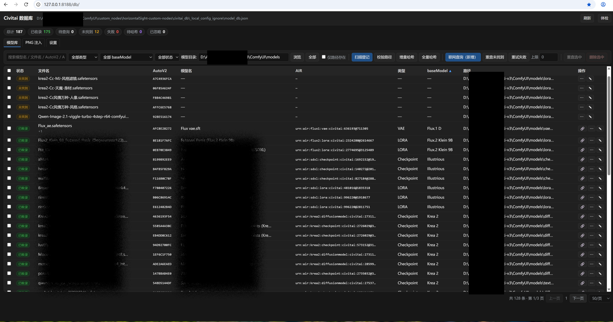
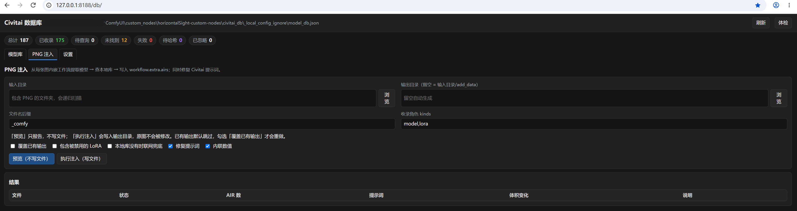
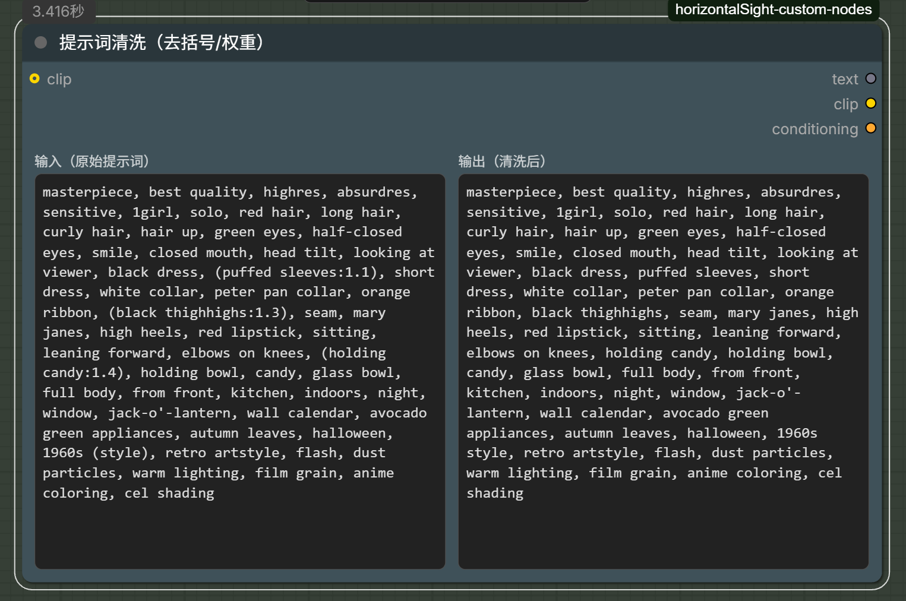

# horizontalSight-custom-nodes

**Comfyui custom nodes 作者：horizontalSight。**

项目由AI辅助构建，如果出现任何问题，都是正常情况。

## 功能

1. 管理本地模型，构建数据库，并提供元数据一键注入图片功能。工作流中用到的模型 AIR、提示词和生成参数写回 PNG；上传到 Civitai 时就能够自动补全所用到的资源、提示词和其他元数据。
   Manage local models, build databases, and provide one-click metadata injection for images. The AIR models, prompts and generation parameters used in the workflow are written back into PNG files. When uploading to Civitai, the referenced resources, prompts and other metadata can be auto-populated.
   
   

2. 提供自定义llama节点，调用本地语言大模型，能够自由使用你所希望用的模型，来分析图片、输出提示词或其他操作。
   Includes a custom Llama node to call local LLMs. You can use any model you prefer for image analysis, prompt generation and other tasks.

3. 提供自定义提示词清洗节点，把带有括号对和权重语法的danbooru提示词，转换为纯净danbooru标签。
   Comes with a custom prompt cleaner node, which converts Danbooru prompts with bracket weighting syntax into clean Danbooru tags.

   

4. 提供顺序保存图片节点，让同一个输出目录下，所有文件名前缀共用一条连续编号。更换 `filename_prefix` 也不会打乱排序。
   Provides a sequential image save node. All files under the same output directory share a continuous sequence number for the filename prefix. Changing `filename_prefix` will not break the ordering.
   

5. 附带了一些工作流，包括A1111/SD webui、Krea2、MOSS、Qwen 2.1、Qwen3-TTS、MiniMax H3、Zimage 等。
   Several example workflows are bundled, including A1111 / SD WebUI, Krea2, MOSS, Qwen 2.1, Qwen3-TTS, MiniMax H3, Zimage, and more.

---

## 说明(从此处起，文本为AI协助生成)

**Disclaimer (Content below is AI-assisted)**

本包是一个 ComfyUI 伞包（facade），把原本分散的节点、文本处理、Civitai 数据库和 llama.cpp 节点集中在一个目录里。节点**类型名保持稳定**，已有工作流不需要改动。

当前共 24 个节点：

| 分类                   | 数量  | 目录            |
| -------------------- | ---:| ------------- |
| 本地节点                 | 5   | `nodes/`      |
| 提示词清洗                | 2   | `text_tools/` |
| Civitai 数据库 / PNG 注入 | 5   | `civitai_db/` |
| llama.cpp            | 12  | `llama_cpp/`  |

## 安装

```
ComfyUI/custom_nodes/horizontalSight-custom-nodes/
```

重启 ComfyUI。启动日志会打印一行确认，例如：

```
[horizontalSight] 伞包已加载: nodes.image_folder=2, nodes.sequence_save=1, nodes.memory=1, nodes.booru_tags=1, text_tools=2, civitai_db=5, llama_cpp=12 | 节点总数 24
```

- `llama_cpp/` 需要 `llama-cpp-python`；
- `text_tools/` 和其余本地节点使用 ComfyUI 自带的 Pillow / numpy / torch，不需要额外依赖；
- `civitai_db/` 的后端只用 Python 标准库，不需要 Pillow 或额外依赖。

## 节点总览（24）

### 本地节点 `nodes/`（5）

| 节点类型                   | 显示名         | 分类             | 作用                                                                                               |
| ---------------------- | ----------- | -------------- | ------------------------------------------------------------------------------------------------ |
| `LoadImagesFromFolder` | 从文件夹读图      | `image/io`     | 把文件夹里所有图片读成一个 batch，并把文件夹路径透传给保存节点                                                               |
| `SaveImagesWithPrompt` | 保存图片(嵌入提示词) | `image/io`     | 回读原图另存，把运行中的工作流嵌进 PNG，并把每张图对应的提示词写进工作流节点                                                         |
| `SequenceImageSave`    | 顺序保存图像      | `image/io`     | 按 `000000_前缀.ext` 保存，同一目录下所有前缀共用连续编号；支持 `[time(%Y-%m-%d)]` 占位符                                   |
| `ClearMemory`          | 清理显存        | `utils`        | 卸载全部模型并清空显存缓存，含 SeedVR2 常驻的 DiT/VAE 缓存；输入原样透传                                                    |
| `BooruTagNormalize`    | Booru 标签归一  | `prompt/booru` | 把 LLM 输出的标签串对齐到本地 Danbooru 词表：别名 → 精确 → 词形 → 可编辑短语表；输出 `tags` / `dropped` / `unknown` / `report` |

### 提示词清洗 `text_tools/`（2）

| 节点类型                | 显示名             | 作用                                            |
| ------------------- | --------------- | --------------------------------------------- |
| `PromptClean`       | 提示词清洗（去括号/权重）   | 删除 `()`、`{}` 和 `:1.2` 这类权重语法，保留其余字符；可单独执行查看结果 |
| `PromptCleanEncode` | CLIP文本编码（清洗+显示） | 清洗后直接做 CLIP 文本编码，节点内显示清洗结果                    |

`PromptClean` 的规则是“只删语法，不改内容”：

- `((masterpiece:1.2))` → `masterpiece`
- `16:9`、`8:00`、`color:red` 这类不像权重的冒号保持原样
- 逗号、空格、换行都保留

### Civitai 数据库 `civitai_db/`（5）

| 节点类型                      | 显示名            | 作用                                             |
| ------------------------- | -------------- | ---------------------------------------------- |
| `CivitaiDBPanel`          | Civitai 数据库面板  | 节点按钮打开 `/db/` 管理面板；执行时返回数据库统计                  |
| `CivitaiModelLookup`      | 查询 Civitai AIR | 按文件名、相对路径或绝对路径查本地库；默认不联网                       |
| `CivitaiDBUpdate`         | Civitai 数据库维护  | 扫描登记、校验路径、增量/全量哈希、联网查询、重查未找到、重试失败              |
| `CivitaiAirsFromWorkflow` | 从工作流提取 AIR     | 读当前 `PROMPT` + `workflow`，解析模型并输出 AIR 列表，只读    |
| `CivitaiInjectImages`     | Civitai PNG 注入 | 批量给文件夹里的 PNG 注入 AIR，并修复 Civitai 提示词；默认 dry-run |

### `llama_cpp/`（12）

自己的 fork，上游是 [lihaoyun6/ComfyUI-llama-cpp_vllm](https://github.com/lihaoyun6/ComfyUI-llama-cpp_vllm)。

| 节点类型                     | 显示名                    |
| ------------------------ | ---------------------- |
| `llama_cpp_model_loader` | Llama-cpp Model Loader |
| `llama_cpp_instruct_adv` | Llama-cpp Instruct     |
| `llama_cpp_parameters`   | Llama-cpp Parameters   |
| `llama_cpp_unload_model` | Llama-cpp Unload Model |
| `llama_cpp_clean_states` | Llama-cpp Clean States |
| `parse_json_node`        | Parse JSON             |
| `json_to_bbox`           | JSON to BBoxes         |
| `bbox_to_segs`           | BBoxes to SEGS         |
| `bbox_to_mask`           | BBoxes to MASK         |
| `bboxes_to_bbox`         | BBoxes to BBox         |
| `remove_code_block`      | Unpack Code Block      |
| `PromptEnhancerPreset`   | Prompt Enhancer Preset |

## Civitai 数据库面板

面板地址：

```
http://127.0.0.1:8188/db/
```

端口以实际 ComfyUI 启动参数为准。旧的 `/civitai-db/` 会 308 跳转到 `/db/`。

面板有三个页签：

- **模型库**：按类型、baseModel、状态、关键词、模型目录筛选；支持排序、右键菜单、编辑、删除、批量操作和体检。
- **PNG 注入**：选择输入/输出目录、后缀、kinds；预览只报告，执行才写文件。已有输出默认跳过，勾选「覆盖已有输出」才重做。
- **设置**：数据库路径、ComfyUI 根目录、API 地址、超时/重试/间隔、扫描类别/后缀、哈希缓存、备份。

首次使用建议按这个顺序：

1. **扫描登记**：按文件名登记模型路径，不计算哈希；
2. **增量哈希**：只处理待哈希记录，转换为正式 AutoV2；
3. **联网查询（新增）**：只查从未查询过的记录；
4. 之前 404 的记录会标成「未找到」，需要时用「重查未找到」；
5. 网络/429/5xx 归为「查询失败」，用「重试失败」。

PNG 注入的注意事项：

- 只替换 PNG 里的 `prompt` / `workflow` 两个文本块，其余块逐字节保留；
- 在写入前做块级自检，自检失败不会落盘；
- 不会在输出目录写 JSON 报告；
- 原图不会被修改，输出文件名默认加 `_comfy` 后缀；
- `CivitaiInjectImages` 节点默认 `dry_run=True`，确认后把节点的 `dry_run` 改为 `false`。

提示词修复的边界：

- 支持直接的 `CLIPTextEncode`、`PrimitiveString*` 和常见的 conditioning 串联节点；
- 如果采样器的 positive/negative 接在 `ComfySwitchNode` 等条件分支的 `on_false` / `on_true` 上，Civitai 不会继续追分支，建议把文字直接接到 `CLIPTextEncode`，或把最终文本写在分支节点上。

### 数据与配置

`civitai_db/` 的本机数据都在：

```
civitai_db/_local_config_ignore/
├── model_db.json       本地模型库（按 AutoV2 索引）
├── config.json         设置
├── hash_cache.json     (路径, 大小, mtime) → SHA256 缓存
├── backups/            每次写库前的备份
└── app.log             日志
```

这个目录已被 `.gitignore` 忽略，**不要提交**。首次使用可以：

- 先在「扫描登记」里扫描模型目录；
- 或在设置里指定已有的 `model_db.json`；
- 「首次导入旧缓存」只用于从旧的 `sha256.json` 迁移哈希缓存，不是必需项。

ComfyUI 根目录默认从插件安装位置推断（`civitai_db` → 向上找到 `main.py` 和 `folder_paths.py`），不需要写死本机路径；设置里仍可手动覆盖。

## 目录结构

```
horizontalSight-custom-nodes/
├── __init__.py              门面：汇总各子模块的 NODE_CLASS_MAPPINGS（含冲突保护）
├── prestartup_script.py     启动期脚本：关掉 ComfyUI 0.30 的 pinned-memory 权重驻留
├── LICENSE                  MIT（llama_cpp/ 除外）
├── nodes/                   本地节点（每个文件独立可读）
│   ├── image_folder.py      LoadImagesFromFolder / SaveImagesWithPrompt
│   ├── sequence_save.py     SequenceImageSave
│   ├── memory.py            ClearMemory
│   └── booru_tags.py        BooruTagNormalize（词表在 ../danbooru/）
├── text_tools/              提示词清洗
│   ├── prompt_clean.py      PromptClean
│   ├── prompt_encode.py     PromptCleanEncode
│   └── web/                 节点内文本预览 + civitai_db_launcher.js
├── civitai_db/              Civitai 数据库、面板、PNG 注入
│   ├── core.py              数据库/扫描/哈希/查询
│   ├── inject.py            PNG 注入 + 提示词修复
│   ├── service.py           配置/任务/锁/缓存
│   ├── api.py               /db/ 路由
│   ├── nodes.py             5 个节点
│   ├── ui/                  面板页面
│   └── _local_config_ignore/ 本机数据（git 忽略）
├── llama_cpp/               12 个 llama.cpp 节点（上游 fork，含 NOTICE）
├── danbooru/                Danbooru 标签表 zip（BooruTagNormalize 的数据源）
├── example_workflows/       示例工作流 .7z 压缩包（每个含一个 JSON）
└── README/                  README 截图
```

## 三个刻意的设计决定

1. **`prestartup_script.py` 必须待在包根**
   `main.py` 只扫描 `custom_nodes/<包名>/prestartup_script.py` 这一层，放进子文件夹不会被执行。
   它在 `model_management` 初始化前把 `args.disable_pinned_memory` 置为 `True`，等效于启动时加
   `--disable-pinned-memory`，避免大模型权重以 pinned 副本同时在显存和内存里各驻留一份。

2. **子模块之间没有重名，但门面仍有冲突保护**
   若出现同名节点，日志会报 `[horizontalSight] 节点类型名冲突: xxx`，保留先加载的那个，而不是静默覆盖。
   任何一个子模块加载失败，只会在日志里报一行，其余节点照常可用。

3. **前端扩展目录只有一个**
   ComfyUI 只认包根模块上的 `WEB_DIRECTORY`，目前指向 `./text_tools/web`。
   `prompt_clean.js` 和 `civitai_db_launcher.js` 都放在这里，由同一个目录统一加载。

## 新增节点

在 `nodes/` 下加一个 `.py`，暴露 `NODE_CLASS_MAPPINGS` / `NODE_DISPLAY_NAME_MAPPINGS`，
然后在门面 `__init__.py` 的加载列表 `("image_folder", "sequence_save", "memory", "booru_tags")` 里加一项。
如果是新的子包（类似 `text_tools/`、`civitai_db/`），在门面里加一行 `_load(...)`，并在需要时把前端脚本放进 `text_tools/web/`。
改完重启 ComfyUI。

## 示例工作流

`example_workflows/` 是随仓库分发的示例工作流，按用途/模型分类：

| 分类                 | 数量  |
| ------------------ | ---:|
| `A1111（SD webui）/` | 2   |
| `Krea2/`           | 2   |
| `llama/`           | 2   |
| `MiniMaxH3/`       | 1   |
| `Moss/`            | 2   |
| `qwen2.1/`         | 2   |
| `Qwen3-TTS/`       | 1   |
| `Zimage/`          | 2   |

共 14 个 `.7z` 压缩包，每个里面一个 JSON。先解压，再把 JSON 拖进 ComfyUI 画布使用；ComfyUI 不会直接加载 `.7z`。

```bash
7z x Krea2-v4.7z
```

示例里的模型名和路径只作演示；如果工作流需要本机模型目录，请改成自己的路径后再运行。

## 依赖

- ComfyUI 自带的 Pillow / numpy / torch；
- `llama_cpp/` 额外需要 `llama-cpp-python`；
- `civitai_db/` 不依赖 Pillow，也不依赖旧的 `civitai_batch_metadata` / `civitai_ckpt_inject` 项目。

## 许可证

- 本仓库根目录采用 MIT，详见 `LICENSE`；
- `llama_cpp/` 是上游项目的 fork，上游没有附带许可证，因此**不在 MIT 范围内**，详见 `llama_cpp/NOTICE`；仅建议个人使用，公开再分发前请先取得版权方许可；
- `danbooru/` 中的词表数据来自 Danbooru 标签归档，来源与校验方式见 `danbooru/README.md`。

## 本地数据与提交

以下目录只属于本机，已被 `.gitignore` 忽略：

- `_local_config_ignore/`：本机笔记、工作流和个人配置；
- `civitai_db/_local_config_ignore/`：模型库、哈希缓存、备份和日志；
- `__pycache__/`、`.venv/`。

提交前请确认不要把这些目录、`model_db.json`、`hash_cache.json`、`app.log` 或 `backups/` 加进仓库。
